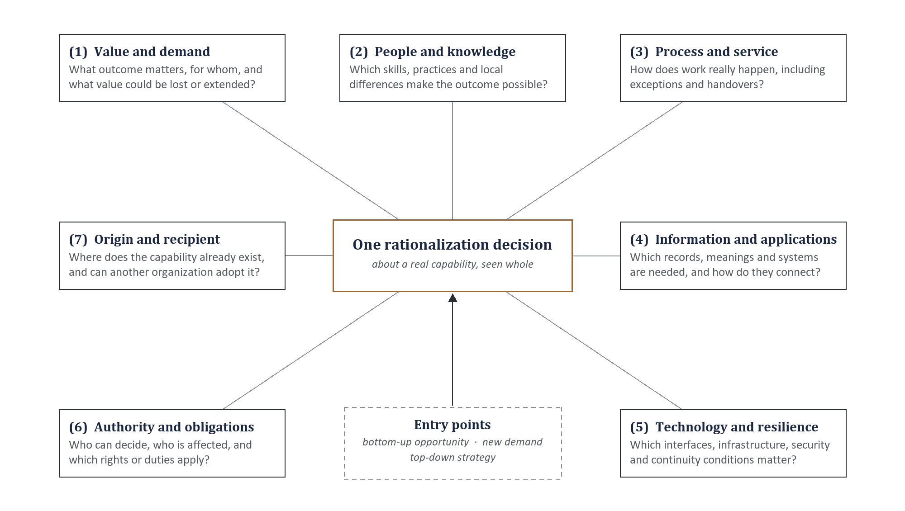

# Unified Rationalization Framework

**Rationalization.AI** is a specific, evidence-led decision technique for deciding what an organisation should preserve, improve, reuse, scale, integrate, consolidate, change, retire, or defer before it commits to an artificial-intelligence solution.

The **Unified Rationalization Framework (URF)** is the broader proposed, platform-neutral structure through which Rationalization.AI and other competent methods can contribute to one accountable decision. It treats AI as one possible response to a real organisational need, not as the starting assumption, and brings business value, people, working knowledge, processes, information, applications, technology, rights, obligations, and decision authority into one proportionate review.

## Why this exists

Promising AI pilots often reach organisations whose data, systems, responsibilities, skills, supplier arrangements, and operating practices are fragmented. Reviewing each part in isolation can repeat discovery, shift costs between departments, hide dependencies, and lead to technology investment before the underlying capability is understood.

Unified rationalization creates one accountable view of that capability. It complements established architecture, portfolio, risk, legal, safety, privacy, labour, cybersecurity, and sector-specific methods; it does not replace them.

## Five practical questions

1. **Why act?** Define the actual problem or opportunity, the people who need the outcome, and a meaningful baseline.
2. **What already exists?** Examine working capabilities, local practices, data, infrastructure, skills, portfolio records, and supplier commitments before commissioning duplicate discovery.
3. **What options are credible?** Compare preservation, improvement, reuse, scaling, integration, consolidation, a defined use of AI, justified deferral, and change or retirement.
4. **What remains unclear or unsafe?** Resolve the human, legal, financial, security, information, and operational gaps that materially affect the choice; refer specialised matters to the appropriate existing regime.
5. **Who decides and sustains the result?** Identify legitimate owners, beneficiaries, implementation responsibilities, dependencies, oversight, and a sensible review point.

## Seven connected views

- **Value and demand:** what outcome matters, for whom, and what existing value might be lost or extended?
- **People and knowledge:** which skills, practices, working relationships, and local differences make that outcome possible?
- **Process and service:** how does work actually happen, including exceptions and handovers?
- **Information and applications:** which records, meanings, systems, and exchanges are necessary?
- **Technology and resilience:** which interfaces, infrastructure, security, continuity, cost, and rollback conditions affect the choice?
- **Authority and obligations:** who can decide, who is affected, and which rights or duties must be respected?
- **Origin and recipient:** where does the useful capability already exist, and can another organisation adopt it responsibly?

These are perspectives on one decision, not seven new audits.

## Board and executive decision tests

G0.11 incorporates an independent board and executive-governance contribution by **Andrea Slingsby**, ASX Non-Executive Director and former CEO. The contribution adds six tests to existing board papers, investment processes, and risk reporting:

1. What problem are we solving?
2. Have we considered the alternatives?
3. Where will value be realised after full lifecycle costs and dependencies?
4. Can we execute successfully?
5. Who is accountable, and what are the authorised boundaries?
6. When do we continue, change, or stop?

An independent banking and cybersecurity applicability review by **Mark Ritcey** is in progress and pending receipt. It is not part of G0.11. Any later incorporation will be separately attributed and versioned.

**Carmen Vargas Carrera** is a project contributor supporting project development, practical review, and stakeholder-facing work. Specific authored material, if incorporated in a future release, will be separately attributed and versioned.

## Stewardship and stakeholder engagement

The initiative is stewarded by **The Integral Management Society (IMSV), Geneva, Switzerland**, with public research and implementation context from **Tegrity.AI** and **JubAp.eu**. Stakeholder and practitioner engagement includes the **Agentic AI Industry Reference Group**. That participation does not transfer authorship or institutional ownership of the framework.

## Public context

- [Rationalization.AI: from useful to indispensable in the age of AI](https://jubap.eu/the-ai-wave-and-rationalization-from-useful-to-essential/)
- [Rationalization as value discovery — Diamond Inside](https://jubap.eu/rationalization-as-value-discovery/)
- [JubAp.eu field notes](https://jubap.eu/field-notes/)
- [Tegrity.AI research initiatives](https://tegrity.ai/research-initiatives/)
- [Tegrity.AI research publication policy](https://tegrity.ai/research-publication-policy/)

## Repository guide

- [FRAMEWORK.md](FRAMEWORK.md) explains the complete G0.11 method and its use.
- [docs/README.md](docs/README.md) provides the complete documentation map and visual overview.
- [docs/DECISION_RECORD_TEMPLATE.md](docs/DECISION_RECORD_TEMPLATE.md) is the working record for one real capability decision.
- [docs/EVALUATION_PROTOCOL.md](docs/EVALUATION_PROTOCOL.md) defines comparators, measures, counterexamples, reporting rules, and the release gate for field evaluation.
- [docs/RESEARCH_LINEAGE.md](docs/RESEARCH_LINEAGE.md) distinguishes historical practice, the 2025 research programme, the 2026 method, and evidence still to be produced.
- [docs/SCIENTIFIC_ANNEX.md](docs/SCIENTIFIC_ANNEX.md) explains Rationalization.AI as a specific technique, its rationale, process, propositions, evidence boundary, and evaluation design.
- [docs/SUBMISSION_REPORT.md](docs/SUBMISSION_REPORT.md) is the controlled attribution and status sheet for the OECD.AI submission draft.
- [annexes/README.md](annexes/README.md) indexes the prepared G0.11 paper, Andrea Slingsby's original contribution, the scientific annex, the submission report, and the reproducible working materials.
- [docs/GLOSSARY.md](docs/GLOSSARY.md) gives plain-language definitions.
- [CONTRIBUTORS.md](CONTRIBUTORS.md) records attribution and contribution status.
- [STATUS.md](STATUS.md) states readiness, institutional boundaries, and version limits.
- [REFERENCES.md](REFERENCES.md) identifies the public methods and sources with which the framework is designed to interoperate.

## Public annexes

The annex register separates prepared project documents from independently authored contributions. It includes the 14-page canonical G0.11 discussion paper and the nine-page contribution received from **Andrea Slingsby**, preserved as received and attributed to her with a verifiable SHA-256 digest. The private email that transmitted the contribution is not published.

## Current status and rights

**G0.11, 22 November 2026 — public discussion draft.** This is not an adopted OECD.AI or GPAI standard, an OECD endorsement, a completed comparative validation, or a claim of regulatory conformity. It is being prepared for submission to the OECD.AI Catalogue of Tools & Metrics and for collective refinement and practical evaluation.

No open-source or reuse licence has yet been granted. The material is public for review and discussion; future reuse terms will be stated in a later release.
