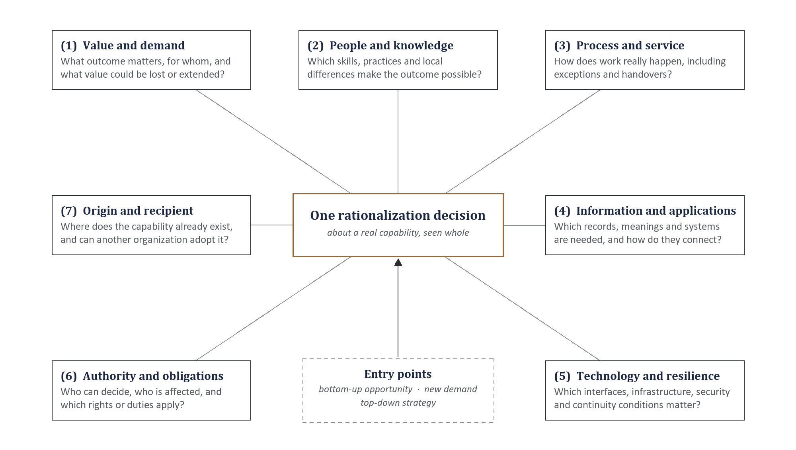
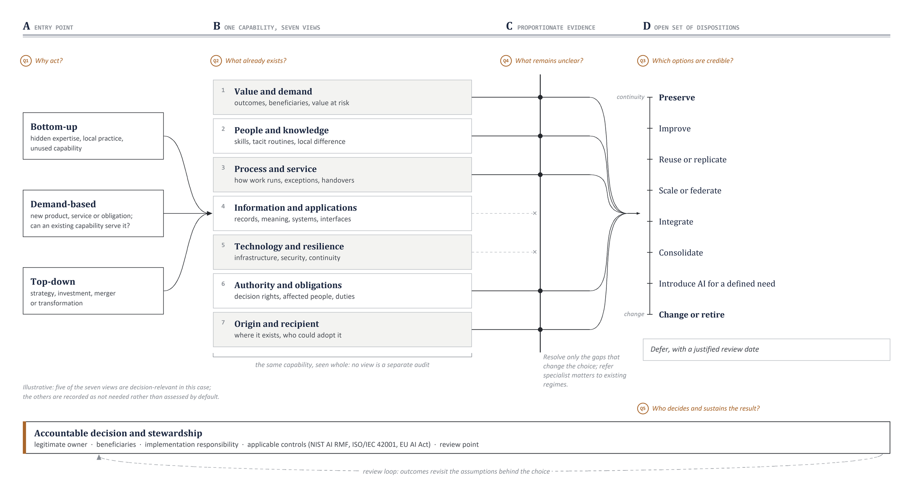

# Documentation guide

This folder turns the Unified Rationalization Framework (URF) G0.12 discussion draft into a reviewable and usable public package. It does not publish IMSV's private correspondence, customer evidence, internal workbooks, or unpublished third-party material.

## Start here

1. Read the [framework](../FRAMEWORK.md) for the method and its boundaries.
2. Use the [decision record template](DECISION_RECORD_TEMPLATE.md) to document one real decision.
3. Use the [evaluation protocol](EVALUATION_PROTOCOL.md) to design a controlled comparison or field case.
4. Consult the [glossary](GLOSSARY.md) for plain-language definitions.
5. Read the [research lineage](RESEARCH_LINEAGE.md) to understand what came from earlier work, what changed, and what remains unvalidated.
6. Read the [scientific annex](SCIENTIFIC_ANNEX.md) for the concise rationale, technique, propositions and evidence boundary.
7. Use the [submission report](SUBMISSION_REPORT.md) to keep contributor and institutional attribution consistent.

## Visual overview

The seven views are perspectives on one decision. They are not seven separate audits, a score, or a mandatory sequence.

A branded presentation version of the seven-view model is also available at [images/urf-seven-views-tegrity.png](images/urf-seven-views-tegrity.png).

## Public package contents

| File | Purpose |
| --- | --- |
| [Framework](../FRAMEWORK.md) | Core G0.12 method, decision range, lifecycle use and evaluation agenda |
| [Decision record template](DECISION_RECORD_TEMPLATE.md) | A practical record for a real capability decision |
| [Evaluation protocol](EVALUATION_PROTOCOL.md) | Comparative research design, measures, failure conditions and reporting rules |
| [Research lineage](RESEARCH_LINEAGE.md) | Documentary origin, revisions and claim boundaries |
| [Scientific annex](SCIENTIFIC_ANNEX.md) | Rationalization.AI as a specific technique, with rationale and testable propositions |
| [Submission report](SUBMISSION_REPORT.md) | Controlled contributor, organisation and status wording for the OECD.AI draft |
| [Glossary](GLOSSARY.md) | Shared, plain-language definitions |
| [References](../REFERENCES.md) | Public sources and interoperability context |
| [Contributors](../CONTRIBUTORS.md) | Attribution and contribution status |
| [Status](../STATUS.md) | Version, readiness, institutional boundaries and rights |
| [Public annex register](../annexes/README.md) | Prepared documents, original contributions, provenance and integrity digests |

## Use boundary

G0.12 is a public discussion draft. The documentation supports review and controlled evaluation. It does not demonstrate that the framework is more effective than competent existing methods, and it does not confer an open licence or imply adoption by OECD.AI, GPAI, a standards body, a client, or a reference group.
