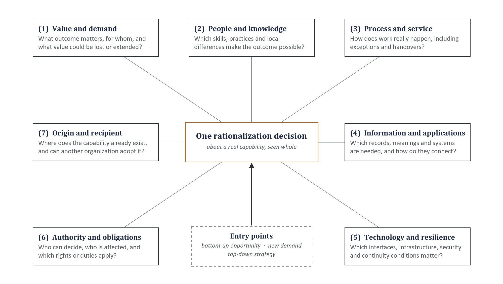
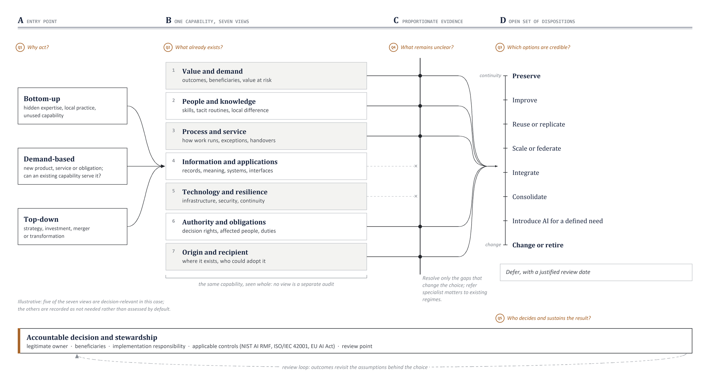

# Scientific annex — Rationalization.AI as a decision technique

**Version:** G0.11 public discussion annex  
**Date:** 22 November 2026  
**Steward:** The Integral Management Society (IMSV), Geneva, Switzerland

## Abstract

Rationalization.AI is a specific, evidence-led technique for deciding what an organisation should do with an existing or proposed capability before it commits to an artificial-intelligence intervention. It treats AI as one credible option among preservation, improvement, reuse, scaling, integration, consolidation, other forms of change, retirement and justified deferral.

The technique responds to a recurrent failure in transformation programmes: the proposed technology is evaluated before the organisation has established what capability already exists, who owns it, which people and knowledge sustain it, what information and dependencies it requires, who may authorise change and where the resulting value must be realised. Rationalization.AI creates a proportionate decision record that makes those elements and the competing options visible together.

The Unified Rationalization Framework (URF) is the broader proposed framework for bringing Rationalization.AI and other competent methods into a shared, platform-neutral decision structure. Rationalization.AI is therefore a specific methodological contribution to URF, not a synonym for every possible implementation of URF.

## 1. Research problem

AI programmes frequently inherit fragmented data, applications, responsibilities, supplier arrangements, skills and operating practices. Narrow technical assessments can identify a model or platform while leaving unanswered whether the underlying organisational capability should be preserved, improved, transferred, consolidated or changed at all.

The problem is not simply incomplete documentation. Some necessary information — such as who owns a capability, which source is authoritative or which organisation may accept a transferred service — may never have been decided. Producing that information is part of the intervention and has a cost, a risk and an authority requirement.

Rationalization.AI asks an upstream question:

> What treatment of the whole capability is justified by the available evidence, the credible alternatives, the rights and obligations involved, and the organisation's capacity to sustain the result?

## 2. Specific technique

The technique is applied to one bounded decision. It is non-linear and may begin with a local opportunity, a new demand or a strategic direction.

### Step 1 — Frame the outcome

State the real problem or opportunity, the people who need the outcome, the baseline, the decision owner and the limits of the review. An AI product is not accepted as the problem statement.

### Step 2 — Describe the capability as a whole

Examine only the evidence material to the decision across seven connected views:

1. value and demand;
2. people and knowledge;
3. process and service;
4. information and applications;
5. technology and resilience;
6. authority and obligations; and
7. origin and recipient.

The views are not separate audits or a scoring model. They prevent a decision about one part of the system from erasing dependencies or value held elsewhere.

### Step 3 — Compare credible dispositions

The review keeps together the options to:

- preserve;
- improve in place;
- reuse or replicate;
- scale or federate;
- integrate or consolidate;
- introduce a defined AI-enabled change;
- make another non-AI change;
- transform, merge or retire; or
- defer with an owner, reason and review point.

Rationalization does not mean compulsory centralisation, cost cutting or application removal. A decision to protect a specialised practice can be as rational as a decision to consolidate genuine duplication.

### Step 4 — Make evidence and uncertainty explicit

Existing portfolio, architecture, process, finance, security, service, legal and operational evidence is reused where suitable. Its source, date, coverage and limitations remain visible. Unknowns are not silently replaced by assumptions.

Specialist questions are handed to the competent legal, privacy, safety, labour, accessibility, cybersecurity, financial, architectural or sector process. Rationalization.AI connects those answers to the decision; it does not replace the specialist regimes.

### Step 5 — Authorise and revisit

The record identifies who may decide, who implements, who receives the value, the authorised boundary, important dependencies, milestones and the conditions to continue, correct, stop or reconsider the choice.

## 3. Intended contribution

The technique is intended to contribute five practical controls:

1. **Whole-capability scope.** People, knowledge, process, information, technology, suppliers and authority are considered together when they materially affect the outcome.
2. **Alternatives before commitment.** Preservation, reuse, non-AI change and justified deferral remain visible beside an AI proposal.
3. **Origin and recipient test.** A capability is not assumed transferable merely because it works elsewhere; the recipient must be able and authorised to sustain it.
4. **Proportionate evidence.** The record is scaled to the impact and reversibility of the decision rather than requiring an exhaustive enterprise inventory.
5. **Accountable continuation.** The approval includes review and stopping conditions, not only permission to begin.

These controls are designed to work with competent existing methods. They do not claim that enterprise architecture, portfolio management, NIST AI RMF, ISO guidance or sector governance lack alternatives or accountability mechanisms.

## 4. Development lineage

The technique grew from enterprise architecture and rationalization practice in decentralised international organisations and from a 2025 research programme that proposed studying whether clarity, strategic alignment and simplification before AI investment could improve readiness.

The 2025 programme proposed hypotheses, surveys, interviews and case studies. It did not complete or validate those studies. During 2026 the work was narrowed into the current bounded technique: the capability became the unit of analysis, non-AI options became explicit, transfers gained an origin-and-recipient test, and novelty or performance claims were converted into propositions that can be challenged.

Historical practice supports plausibility and design provenance. It does not establish general causal effectiveness.

## 5. Testable propositions

A controlled evaluation can test whether, compared with a competent existing method, Rationalization.AI:

- identifies more credible alternatives without creating disproportionate delay;
- exposes material dependencies, decision rights and evidence gaps earlier;
- distinguishes valued local variation from genuine duplication;
- reduces repeated discovery by reusing reliable evidence;
- improves the traceability of capital, benefit and stopping decisions;
- helps separate justified AI uses from stronger non-AI alternatives; and
- improves transfer decisions by testing recipient readiness.

The propositions can fail. A valid study must report cases in which an existing method produces the same or a better decision with less effort, the seven views add no material information, or the technique creates duplicate governance.

## 6. Evaluation design

The public [evaluation protocol](EVALUATION_PROTOCOL.md) requires a real decision, a competent comparator, a baseline, measures selected before analysis, independent review where feasible, a stated review point and publication of negative findings. It explicitly rejects a universal score unless the weighting and validity of that score have been independently established.

Candidate measures include alternative coverage, evidence provenance, owner and handoff completeness, visibility of dependencies, decision time and effort, issues discovered after approval, avoidable intervention cost, sustained value and successful or failed transfer.

## 7. Evidence and institutional status

Three evidence classes remain separate:

- documented historical practice;
- the later methodological abstraction represented by G0.11; and
- prospective comparative evaluation.

G0.11 is a public discussion draft. It is not a completed validation, an international standard, a certification scheme or proof of legal conformity. Preparation for an OECD.AI catalogue submission and engagement with practitioners do not imply OECD, GPAI, standards-body, client or reference-group adoption or endorsement.

## 8. Contribution and governance

The technique is proposed by **Iván Abril Palma** and stewarded through **The Integral Management Society (IMSV)**, with public research and implementation context from **Tegrity.AI** and **JubAp.eu**.

G0.11 incorporates the independent board and executive-governance contribution of **Andrea Slingsby**. **Carmen Vargas Carrera** contributes to project development, practical review and stakeholder-facing work. An independent banking and cybersecurity applicability review by **Mark Ritcey** is pending and is not treated as incorporated evidence until received and evaluated.

The detailed contribution states and institutional boundaries are recorded in the [submission report](SUBMISSION_REPORT.md) and [contributors file](../CONTRIBUTORS.md).

The [public annex register](../annexes/README.md) also preserves Andrea Slingsby's independently authored contribution and the prepared G0.11 discussion paper with provenance and integrity digests.

## 9. Reproducible public materials

The repository provides:

- the [G0.11 framework](../FRAMEWORK.md);
- a [decision-record template](DECISION_RECORD_TEMPLATE.md);
- a [controlled evaluation protocol](EVALUATION_PROTOCOL.md);
- the [research lineage and evidence boundary](RESEARCH_LINEAGE.md);
- a [plain-language glossary](GLOSSARY.md); and
- the [public references and interoperability context](../REFERENCES.md).

Together these materials allow expert review and controlled field evaluation without publishing private correspondence, customer evidence, unpublished workbooks or third-party protected material.
